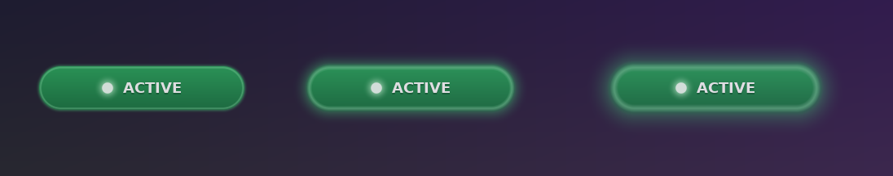

<p align="center">
  
</p>

<h1 align="center">AntiDialog</h1>
<p align="center"><b>for Genshin Impact (or any game)</b></p>

<p align="center">
  A tiny, portable auto-presser for skipping dialogue. Toggle it from anywhere with <b>F7</b>,
  and see at a glance whether it's running thanks to a breathing "ACTIVE" overlay on top of your game.
</p>

<p align="center">
  
</p>

## Features

- **One portable `.exe`**: no installer, no runtime, no DLLs. About 75 KB.
- **Global F7 hotkey** starts and stops it, even while the game has focus.
- **Action:** repeat any **keyboard key** (default: **F**), or **left / right mouse click**.
- **Adjustable interval** in milliseconds.
- **Game-friendly input:** keys are sent as hardware scan codes, which is what most games read.
- **On-screen overlay:** a green "ACTIVE" capsule at the top-right that slowly breathes while AntiDialog is running.
  - Turn it on or off with a switch.
  - **Transparency** slider (0–90 %).
  - **Blur** slider (0–100 %) for softer edges and glow.
  - Click-through, never steals focus, and is hidden from the taskbar.
- **Settings are saved automatically** to `%APPDATA%\AntiDialog\config.ini`.

## Download

Get `AntiDialog.exe` from the [**Releases**](../../releases) page and run it. There is nothing to install.

> **Windows SmartScreen:** the executable isn't code-signed, so Windows may show a blue warning the first time you run it.
> Click **More info → Run anyway**.
>
> **Administrator prompt:** this is expected. See [why it needs admin and what it does with it](#why-does-it-ask-for-administrator-rights-is-it-safe).

## Why does it ask for administrator rights? Is it safe?

**Short answer:** Genshin Impact runs as administrator, and Windows doesn't let a normal program send keys or clicks to an administrator window.
That's the only reason AntiDialog asks for admin.

**Details:**

- Windows has a protection called **UIPI** (User Interface Privilege Isolation). A program running at normal privileges **cannot send input to a program running elevated**.
  Genshin Impact (and many other games with anti-cheat) run elevated, so without admin rights AntiDialog's key presses would silently be ignored.
- The only way around this without admin is the `uiAccess` manifest flag. Windows only allows that for **code-signed** apps **installed in Program Files**,
  which would mean a paid certificate and no longer being portable.

**What AntiDialog does with those rights, and what it doesn't:**

| ✅ It does | ❌ It never does |
|---|---|
| Sends the key or click you chose, using the standard Windows `SendInput` API | Inject code into, read from, or modify the game or any other process |
| Reads the F7 key state (`GetAsyncKeyState`) to start and stop | Log or record your keystrokes |
| Draws its own overlay window on top of the screen | Connect to the internet: it has no networking code at all |
| Saves its settings to `%APPDATA%\AntiDialog\config.ini` (or next to the `.exe` if AppData isn't writable) | Write anywhere else, install services or drivers, or touch the registry |
| Opens the PayPal link in your browser **only if you click** Donate | Run at startup or keep running after you close it |

**Don't just trust this README. Verify it yourself:**

- The **whole program is one readable C file**: [`src/antidialog.c`](src/antidialog.c). Every Windows function it can call is listed in [`build.sh`](build.sh),
  because the import libraries are generated from that exact list. There is no networking, registry, process-memory or hooking API in it.
- **Build it yourself** with `./build.sh` (see [Building from source](#building-from-source)). The build is **reproducible**: with the same compiler version you get a byte-identical `.exe`, so its SHA-256 matches the release.
- Each release lists the file's **SHA-256** hash, so you can check that your download matches:
  `Get-FileHash .\AntiDialog.exe -Algorithm SHA256` in PowerShell.
- Upload it to [VirusTotal](https://www.virustotal.com) if you like. A few heuristic engines may flag *any* auto-clicker
  just because it sends simulated input. That's expected for this kind of tool.

## How to use

1. Choose an **Action**: *Keyboard key*, *Left click* or *Right click*.
2. For a keyboard key, press **Set key** and then the key you want. The default is **F**.
3. Set the **Interval (ms)**. For example, 100 = 10 presses per second.
4. Press **F7** (or the Start button) to start, and **F7** again to stop.

### Overlay doesn't show up in game?

Normal windows can't draw over a game running in **exclusive fullscreen**.
Run the game in **windowed / borderless** mode. For Genshin Impact, you can add the `-popupwindow` launch argument for borderless.
AntiDialog never injects anything into the game process.

## ⚠️ Disclaimer

- **Use at your own risk.** Many online games forbid automation tools in their Terms of Service.
  HoYoverse in particular has warned that using macros to skip dialogue in Genshin Impact can lead to **bans and the removal of in-game currency**.
  The authors take no responsibility for any account action.
- This project is **not affiliated with, endorsed by, or connected to HoYoverse / COGNOSPHERE**.
  *Genshin Impact* is a trademark of its respective owner and is mentioned only to describe compatibility.

## Building from source

AntiDialog is plain C against the Win32 API, with no C runtime. It cross-compiles from Linux or macOS with LLVM, and no Windows SDK is needed:

```bash
# Debian/Ubuntu: sudo apt install clang lld llvm
./build.sh
# -> build/AntiDialog.exe
```

| Path | Contents |
|---|---|
| `src/antidialog.c` | All of the program's code |
| `res/app.rc`, `res/app.manifest`, `res/icon.ico` | Version info, manifest (admin + DPI + visual styles) and icon |
| `build.sh` | Generates the import libraries and builds the exe |

## Support

If AntiDialog saves you some clicks, you can support it on [PayPal](https://www.paypal.me/JanSan280406). Thank you! 💚

## License

[MIT](LICENSE)
